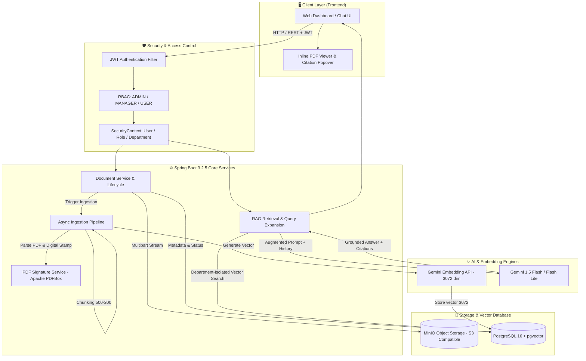
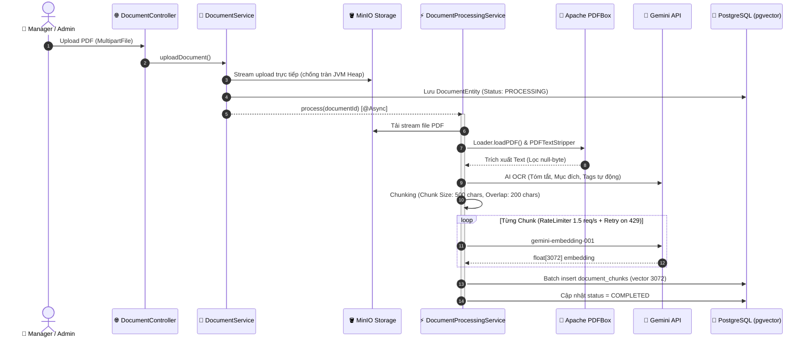
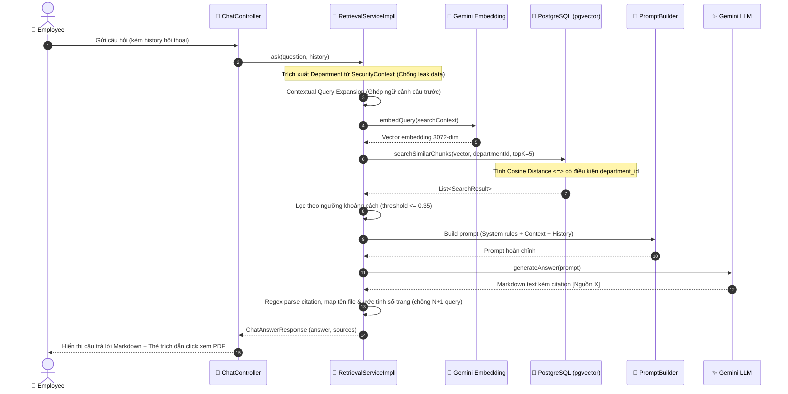

# 🚀 DocuMind — Internal Document Management & AI Chatbot System (IDMS)

<div align="center">


<p align="center">
  <b>Hệ thống Quản lý Tài liệu Doanh nghiệp & Trợ lý Ảo AI RAG Phân Quyền Đa Phòng Ban</b><br>
  <i>Enterprise Document Management Platform with Department-Isolated Retrieval-Augmented Generation (RAG) & Grounded Citations</i>
</p>

</div>

---

## 📖 1. Giới thiệu tổng quan (Overview)

Trong các tổ chức và doanh nghiệp lớn, việc tra cứu chính sách, biểu mẫu, quy trình nội bộ từ hàng trăm tài liệu PDF thường tốn nhiều thời gian và dễ nhầm lẫn phiên bản. Đồng thời, bảo mật thông tin nội bộ giữa các phòng ban (nhân sự, tài chính, kỹ thuật...) là yếu tố sống còn.

**DocuMind (IDMS)** là nền tảng quản lý tài liệu thông minh kết hợp trợ lý AI hỏi đáp nội bộ:
- **Tập trung hóa tài liệu:** Quản lý vòng đời tài liệu (tải lên, phê duyệt, ký duyệt số, phân loại theo phòng ban, soft-delete).
- **Hỏi đáp thông minh (RAG):** Trả lời câu hỏi tự nhiên dựa trên chính xác ngữ cảnh tài liệu nội bộ, trích dẫn rõ nguồn trang (`[Nguồn X]`) giúp đối chiếu thông tin ngay lập tức.
- **Bảo mật phân quyền nghiêm ngặt (Department Data Isolation):** Người dùng thuộc phòng ban nào chỉ được tra cứu và AI chỉ được tìm kiếm ngữ cảnh thuộc phòng ban đó và tài liệu chung toàn công ty, tuyệt đối không lộ dữ liệu chéo phòng ban.

---

## 🏗️ 2. Kiến trúc hệ thống (System Architecture)



---

## ⚡ 3. Các luồng xử lý lõi (Core Pipelines)

### 🔹 Luồng 1: Xử lý & Nạp tài liệu tự động (Document Ingestion Pipeline)



### 🔹 Luồng 2: Truy xuất RAG & Hỏi đáp thông minh (Query & Retrieval Pipeline)



---

## 🌟 4. Các tính năng nổi bật & Kỹ thuật chuyên sâu

### 1. Phân quyền & Cô lập dữ liệu phòng ban (Department Isolation)
- `SecurityContext` là **nguồn xác thực duy nhất**. Phòng ban của người dùng được lấy trực tiếp từ JWT payload đã xác thực, tuyệt đối **không nhận department_id từ Request Body/Query** của client để chống tấn công giả mạo (IDOR).
- Câu truy vấn Vector Search luôn kèm điều kiện lọc: `(department_id = :deptId OR department_id IS NULL)` (chỉ lấy tài liệu phòng ban mình hoặc tài liệu chung).

### 2. Tối ưu bộ nhớ & Stream I/O chống tràn RAM (JVM Heap OOM)
- File dung lượng lớn (lên đến 20MB-50MB) được truyền thẳng từ `MultipartFile.getInputStream()` vào `MinioClient.putObject()` bằng cơ chế Stream, không đọc toàn bộ mảng byte `readAllBytes()` vào RAM gây quá tải bộ nhớ.
- Xử lý nạp tài liệu nạp ngầm bằng `@Async` chạy trên thread pool độc lập, không block request người dùng.

### 3. Vector Embeddings 3072 chiều & Hibernate Custom Type
- Tích hợp model hiện đại **`gemini-embedding-001`** cho độ chính xác ngữ nghĩa vượt trội với vector kích thước **3072 chiều**.
- Xây dựng class custom `VectorType` triển khai Hibernate `UserType` để map trực tiếp giữa mảng `float[]` trong Java và kiểu dữ liệu `vector(3072)` của tiện ích mở rộng `pgvector` trên PostgreSQL.

### 4. Kiểm soát Rate Limit & Cơ chế Retry thông minh
- Gọi API Embedding được điều phối thông qua Guava `RateLimiter` (1.5 request/s) để tránh chạm ngưỡng giới hạn của Google Cloud API.
- Tự động bắt lỗi HTTP `429 Too Many Requests` và thực hiện Exponential Backoff retry tối đa 3 lần.

### 5. Prompt Engineering & Kiểm chứng nguồn trích dẫn (Grounded Citations)
- Thiết lập quy tắc **Soft Refusal & Strict Hallucination Guard**: Nếu tài liệu không chứa thông tin hoặc hỏi về thực thể ngoài luồng, mô hình sẽ từ chối lịch sự và hướng dẫn người dùng thay vì tự bịa câu trả lời.
- Thuật toán Regex nhận diện thẻ trích dẫn `[0]`, `[Nguồn 0]`, tự động gom nhóm ID tài liệu để query hàng loạt (`findAllById`), loại bỏ hoàn toàn vấn đề N+1 query database.

### 6. Đóng dấu & Chữ ký số điện tử trên PDF (Digital Stamping)
- Sử dụng **Apache PDFBox** để xử lý cấu trúc trang PDF, tính toán ma trận tọa độ, tỷ lệ co giãn (aspect ratio) và chèn ảnh chữ ký của Quản lý (`PDImageXObject`) khi duyệt tài liệu.

---

## 🛠️ 5. Công nghệ sử dụng (Tech Stack)

| Thành phần | Công nghệ | Chi tiết |
| :--- | :--- | :--- |
| **Backend Framework** | Java 21, Spring Boot 3.2.5 | Spring Data JPA, Spring Security 6, Spring Web |
| **Authentication** | JJWT (io.jsonwebtoken 0.12.6) | Stateless Token, Refresh Token, RBAC |
| **PDF Processing** | Apache PDFBox 3.0.2 | Text Stripping, Image Stamping, Document Rendering |
| **Vector Database** | PostgreSQL 16 + pgvector 0.1.6 | Cosine Distance `<=>`, HNSW / IVFFlat indexing |
| **Object Storage** | MinIO Storage Java SDK 8.5.7 | Lưu trữ phân tán tương thích chuẩn AWS S3 |
| **AI / LLM** | Google Gemini API | `gemini-embedding-001` (3072-dim), `gemini-1.5-flash` |
| **Concurrency / Tools** | Guava RateLimiter, Lombok, ModelMapper | Xử lý rate limit, mapping dữ liệu |
| **Frontend** | HTML5, Vanilla JavaScript, CSS3 | Giao diện Responsive phong cách NotebookLM, PDF.js |
| **DevOps** | Docker, Docker Compose | Khởi chạy toàn bộ hạ tầng cơ sở dữ liệu và lưu trữ |

---

## 🚀 6. Hướng dẫn cài đặt & Khởi chạy (Getting Started)

### Yêu cầu hệ thống (Prerequisites)
- **JDK:** Java 21 LTS trở lên
- **Maven:** 3.8+
- **Docker & Docker Compose**
- **Google Gemini API Key** (Đăng ký miễn phí tại [Google AI Studio](https://aistudio.google.com/))

### Bước 1: Clone dự án
```bash
git clone https://github.com/thaitr9999-dev/AI-Document-Chatbot.git
cd AI-Document-Chatbot
```

### Bước 2: Khởi chạy hạ tầng bằng Docker Compose
Dự án đã cấu hình sẵn Docker Compose cho PostgreSQL (có sẵn tiện ích mở rộng `pgvector`) và MinIO Storage:

```bash
docker-compose up -d
```
* PostgreSQL khởi chạy tại cổng: `localhost:5432`
* MinIO Web Console tại: `http://localhost:9001` (User: `minioadmin` / Pass: `minioadmin`)

### Bước 3: Cấu hình biến môi trường (`application.properties`)
Mở file `src/main/resources/application.properties` và cập nhật khóa API Gemini của bạn:

```properties
# Gemini API Key
gemini.api.key=YOUR_GEMINI_API_KEY_HERE
gemini.api.embedding-url=https://generativelanguage.googleapis.com/v1beta/models/gemini-embedding-001:embedContent
gemini.api.chat-url=https://generativelanguage.googleapis.com/v1beta/models/gemini-1.5-flash:generateContent

# Cấu hình Database & MinIO (Mặc định theo docker-compose)
spring.datasource.url=jdbc:postgresql://localhost:5432/idms
spring.datasource.username=postgres
spring.datasource.password=123456
minio.endpoint=http://localhost:9000
minio.access-key=minioadmin
minio.secret-key=minioadmin
minio.bucket-name=idms-documents
```

### Bước 4: Biên dịch và chạy ứng dụng
```bash
mvn clean compile
mvn spring-boot:run
```

Truy cập ứng dụng tại trình duyệt: **`http://localhost:8080/login`**

Tài khoản dùng thử mặc định (đã khởi tạo trong database):
* **Admin:** `admin@example.com` / `123456`
* **Manager:** `manager@example.com` / `123456`
* **User (Nhân viên):** `user@example.com` / `123456`

---

## 📡 7. Danh mục API chính (Key REST API Endpoints)

### 🔐 Authentication (`/api/auth`)
| Method | Endpoint | Mô tả | Quyền |
| :--- | :--- | :--- | :--- |
| `POST` | `/api/auth/login` | Đăng nhập nhận JWT Access & Refresh Token | Public |
| `POST` | `/api/auth/refresh-token` | Làm mới Access Token khi hết hạn | Public |
| `POST` | `/api/auth/forgot-password`| Gửi mã OTP khôi phục mật khẩu qua Email | Public |
| `POST` | `/api/auth/verify-otp` | Xác thực mã OTP | Public |

### 📑 Document Management (`/api/documents`)
| Method | Endpoint | Mô tả | Quyền |
| :--- | :--- | :--- | :--- |
| `POST` | `/api/documents/upload` | Tải lên file PDF & kích hoạt nạp AI RAG | USER, MANAGER, ADMIN |
| `GET` | `/api/documents` | Lấy danh sách tài liệu theo phân quyền phòng ban | USER, MANAGER, ADMIN |
| `GET` | `/api/documents/{id}/view` | Xem nội dung stream file PDF | USER, MANAGER, ADMIN |
| `POST` | `/api/documents/{id}/approve`| Quản lý phê duyệt & đóng dấu chữ ký số | MANAGER, ADMIN |
| `DELETE`| `/api/documents/{id}` | Xóa mềm tài liệu (Soft-delete) | MANAGER, ADMIN |

### 💬 AI RAG Chatbot (`/api/chat`)
| Method | Endpoint | Mô tả | Quyền |
| :--- | :--- | :--- | :--- |
| `POST` | `/api/chat/sessions` | Tạo phiên hội thoại chat mới | USER, MANAGER, ADMIN |
| `GET` | `/api/chat/sessions` | Lấy lịch sử các phiên chat của người dùng | USER, MANAGER, ADMIN |
| `POST` | `/api/chat/ask` | Gửi câu hỏi, thực hiện RAG và trả lời kèm Citation | USER, MANAGER, ADMIN |
| `GET` | `/api/chat/sessions/{id}/messages` | Lấy toàn bộ tin nhắn trong phiên chat | USER, MANAGER, ADMIN |

---

## 👨‍💻 Tác giả (Author)

* **Kim Nguyễn Thái Trường**
* Sinh viên Toán - Tin (Mathematics & Computer Science) — Đại học Khoa học Tự nhiên, ĐHQGHN (VNU-HUS)
* **GitHub:** [@thaitr9999-dev](https://github.com/thaitr9999-dev)
* **Email:** kimtruongforwork@gmail.com
